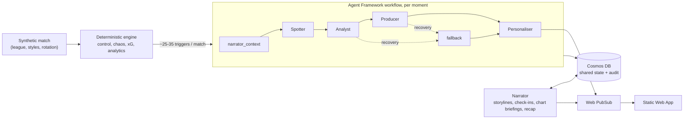

# Match Health AI

**Observability for football.** Match Health watches a match the way an SRE watches a system: a deterministic engine tracks each team's *control* and raises alerts when something important happens. A crew of five AI agents then works like a TV production team. They decide whether the moment matters, explain *why* it matters, render it as a broadcast overlay, and rewrite it for every viewer, in seconds.

**Live demo:** https://polite-wave-086f2900f.2.azurestaticapps.net
A new fictional match kicks off every 20 minutes, replayed at 6× speed (about 15 minutes per match), followed by its full-time recap. Opening the page mid-match shows everything so far straight away.

Built for the Microsoft × Premier League *Inside the Game* hackathon. All teams, players and data are synthetic.

---

## What a viewer gets

| Casual mode (the story) | Analyst mode (the numbers) |
|---|---|
| The latest moment as a big headline, with *why* it matters | Key numbers: win chance, xG, control, possession, each with a one-line reading |
| The **Match story**: pre-match storylines, 15', half-time and 60' check-ins, full-time recap | **Charts** behind tabs: xG race, win probability, pressing (PPDA), field tilt, zones, player profile, hard passes, shot map |
| **On air**: the overlay exactly as a broadcast would show it, on a pitch replaying the real event positions (full-screen available) | **Summarise these charts**: an AI briefing of what the charts say |
| Line-ups with benches, substitutions, and changes since the last two games | Passing table with progressive passes, accuracy under pressure, and accuracy against the last two games |

Every view is available in **English, Español, Français, Português and Deutsch**, written natively by the model. Viewers can **follow a player** and **pin one metric** they care about to the pitch.

## How it works



1. **Code before AI.** The engine is plain, deterministic Python. It computes every number and decides *when* something is worth explaining. The AI never invents statistics; it explains the ones it's given.
2. **Five agents with distinct jobs**, orchestrated as a **Microsoft Agent Framework** `Workflow` ([graph](docs/agent-workflow.md)):

   | Agent | Job | Model |
   |---|---|---|
   | Spotter | Is this a story? Sets priority | nano |
   | Analyst | Explains *why* it matters, citing only the facts given | mini |
   | Producer | Turns it into a timed overlay, validated against [a JSON schema](schemas/overlay.schema.json) | nano |
   | Personaliser | Writes every mode × language version in **one** call | nano |
   | Narrator | Tells the whole match: storylines, check-ins, chart briefings, recap | mini / nano |

3. **Shared state.** Every handoff is saved to Cosmos DB per moment, and the Narrator reads what the crew wrote. Each Narrator text is stored with the exact facts it was allowed to cite.
4. **Never a blank broadcast.** Timeouts, invalid output or invented numbers route along a recovery edge to a stats-only overlay, and the failure is recorded per stage.

More: [architecture and costs](docs/architecture.md) · [agent workflow](docs/agent-workflow.md) · [overlay contract](docs/overlay-contract.md)

## Built with Microsoft

| Need | Service |
|---|---|
| Models | **Microsoft Foundry** (`gpt-4.1-mini`), via managed identity |
| Agent orchestration | **Microsoft Agent Framework** (`agent-framework-core`): Workflow, Executors, conditional edges |
| Run the match and the agents | **Azure Container Apps** jobs (scheduled demo, on-demand real-model runs), scale to zero |
| Shared agent state, audit, live snapshot | **Azure Cosmos DB** (free tier) |
| Push to viewers | **Azure Web PubSub** (free tier) |
| Frontend | **Azure Static Web Apps** (free tier) |
| Token service for browsers | Container App (`negotiate_service.py`) |
| CI/CD | **GitHub Actions**: tests, container image to GHCR, site deploy |

No API keys anywhere: every service is reached through **managed identity**.

## Can you trust what it says?

Accuracy is checked in code, on every live match, not just promised in a prompt.

- **Grounding guard** ([`agents/grounding.py`](src/matchhealth/agents/grounding.py)): every number in AI-written text must appear in the facts that agent received. An invented number ("his 7th goal" when the facts say 6) is blocked. The text falls back to a template written from the same facts, and the rejection is recorded.
- **Full-time pipeline audit** ([`audit.py`](src/matchhealth/audit.py)): read back from Cosmos, it checks that every confirmed moment went through every agent, or that a recorded recovery explains the gap, and that it reached viewers. The result appears on the page.
- **34 tests**, including accuracy tests that replay the same seeded match and compare what was reported with what happened: goals, scorers and minutes, recap and check-in scores, season tallies, analytics on hand-built events, and grounding.

## Synthetic data, football-realistic

- A fictional **eight-club league**. Each club has a playing style (press, tempo, directness, strength) that shapes its event stream, so a high-press side really does press harder in the charts.
- **Squad rotation** (0–3 changes per matchweek), **benches and substitutions**, and a simulated season so far for the table, form, streaks and top scorers.
- Tuned to real rates: about 23 shots, 3 goals and 24 fouls per match.

## Run it locally (no Azure needed)

```bash
python -m venv .venv && source .venv/bin/activate      # Windows: .venv\Scripts\activate
pip install -e ".[dev,preview]"
python -m matchhealth.run --offline --preview --speed 20 --home hollowbrook --away kingsmere
# then open web/index.html in a browser (file:// is fine)
```

- `--offline` ignores any Azure settings in `.env`: mock agents, in-memory state.
- `--speed 1` is real time; `--speed 0` runs as fast as possible.
- `--list-clubs` shows the league.
- Run the tests with `pytest`.

To use the real model, set the variables in [`.env.example`](.env.example) and drop `--offline`.

## How it maps to the judging criteria

| Criterion | Where to look |
|---|---|
| Technological implementation | Deterministic engine plus agents; Agent Framework workflow; JSON-schema-validated output; 34 tests in CI; managed identity; tuned synthetic data with a season, rotation and benches |
| Agentic design and innovation | Five agents with distinct roles; shared state in Cosmos; the Narrator works across the match from what the crew saved; recovery edges; grounding guard and audit |
| Real-world impact | A drop-in for a broadcaster's graphics desk: [event schema](schemas/event.schema.json) in, [overlay schema](schemas/overlay.schema.json) out; costs a few cents per match; five languages from one call |
| User experience | Two genuinely different modes, live charts, instant load mid-match, full-screen broadcast view |
| Category: Best Multi-Agent System | Distinct roles, handoffs through shared state, recovery from failures, an end-to-end result no single agent could produce: [agent workflow](docs/agent-workflow.md) |

## Honest limitations

- **The public demo runs in mock mode** to stay free during judging: the same pipeline, with hand-written templates instead of model calls, in all five languages. The demo video is recorded from this public demo. The Foundry-backed crew (gpt-4.1-mini) runs on demand with the `matchhealth-replay` job.
- **No video auto-eventing.** Events are generated, not detected from footage. The engine consumes a plain [event schema](schemas/event.schema.json), so a real tracking or event feed could replace the generator.
- `infra/main.bicep` documents the deployed topology but has not been re-validated end to end. The live resources were created with the Azure CLI; the demo job's definition is in [`infra/demo-job.yaml`](infra/demo-job.yaml).

## Repository layout

```
src/matchhealth/
  replay/     league, season simulation, match generator, replayer
  engine/     health (control/chaos), stats, thresholds (triggers), analytics
  agents/     crew (Spotter, Analyst, Producer, Personaliser), narrator, orchestrator
              (Agent Framework workflow), grounding guard, mock text, prompts/
  shared/     models, state (in-memory and Cosmos)
  run.py      one match end to end · audit.py · negotiate_service.py
web/          the live page (single static file)
schemas/      event and overlay JSON schemas
infra/        Bicep and the demo job definition
tests/        pipeline and accuracy tests
```
