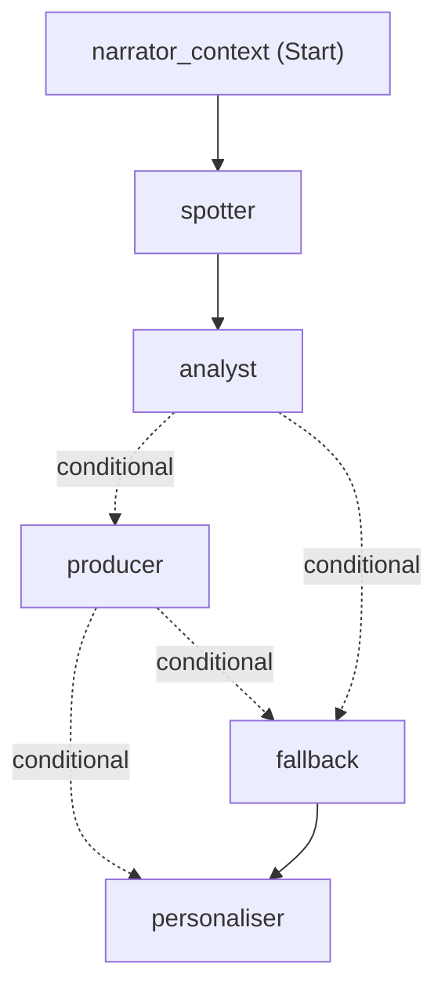

# Agent workflow

Each moment the engine flags runs through one **Microsoft Agent Framework** workflow (`agents/orchestrator.py`). Every agent is an `Executor`, every handoff is a typed message on an edge, and every handoff is also written to shared state (Cosmos DB in Azure). The graph below is generated from the real workflow with `WorkflowViz(...).to_mermaid()`.



| Executor | Agent | Job | Model tier | On failure |
|---|---|---|---|---|
| `narrator_context` | Narrator | Adds season facts to the trigger (e.g. a scorer's season tally), records it in shared state | none (code) | — |
| `spotter` | Spotter | Confirm or reject, set priority | nano | Fails open with the engine's priority |
| `analyst` | Analyst | Explain *why* it matters, citing only given facts | mini | `Recovery` edge → `fallback` |
| `producer` | Producer | Timed overlay spec, validated against `schemas/overlay.schema.json` | nano | `Recovery` edge → `fallback` |
| `fallback` | — | Stats-only overlay from the engine's facts: never a blank broadcast | none | — |
| `personaliser` | Personaliser | Every persona's variant in one call; can't change template, timing or priority | nano | Base overlay only |

Recoveries are recorded per stage in the moment's document (`recovery.{spotter,analyst,producer}`), so the audit trail shows exactly what failed and what the viewer saw instead.

Across the match, the **Narrator** (`agents/narrator.py`) reads the moments this workflow wrote and produces the storylines, the 15'/half-time/60' checkpoints and the full-time recap.

Regenerate the diagram:

```bash
python -c "from agent_framework import WorkflowViz; from matchhealth.agents.orchestrator import Orchestrator; from matchhealth.shared.state import InMemoryStore; import asyncio; print(WorkflowViz(Orchestrator(InMemoryStore(), None).workflow).to_mermaid())"
```
